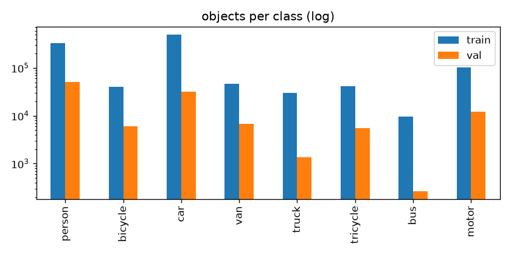
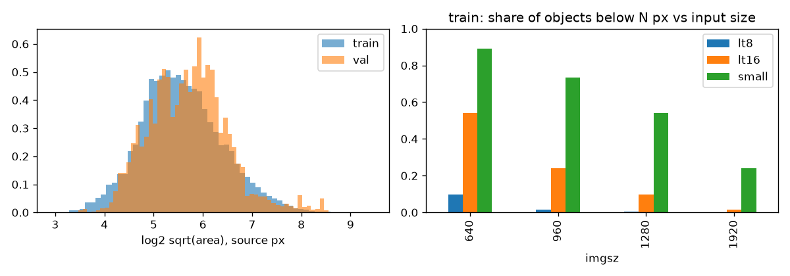
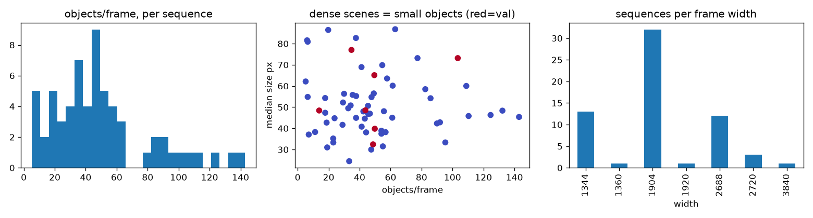
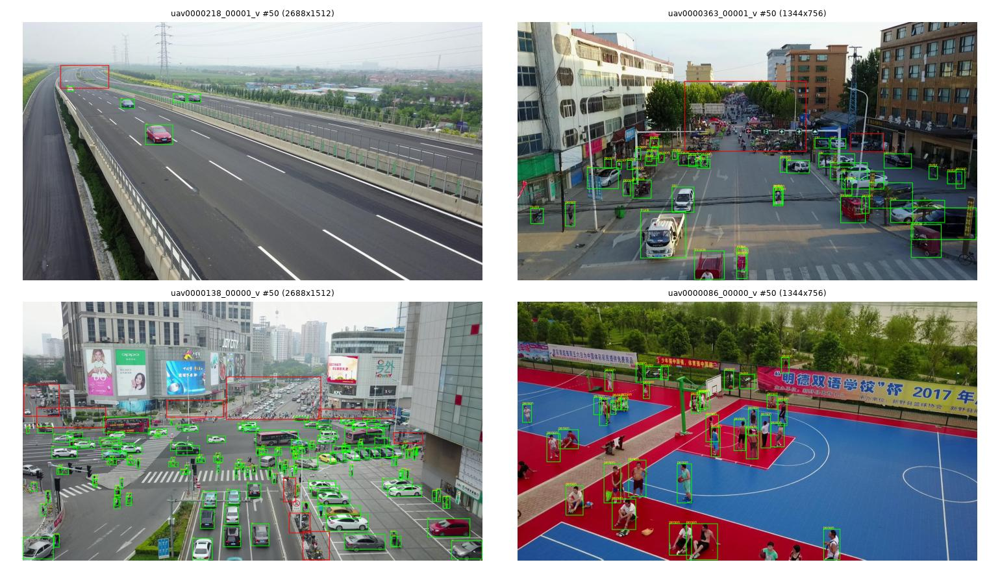

## Data preparation

1. **Sequence split and class imbalance:** The dataset has 24,201 training frames (56 clips), 2,846 validation frames (7 clips), and 3,811 test frames (48 clips) with no clip overlap. We kept this sequence-level split to avoid frame leakage. Classes are not equally distributed: **car** (46%) and **person** (30%) dominate training, while validation has more **person** (44%) than **car** (28%), and **bus** is only 0.9% of training objects.

2. **Small, dense objects:** Frames average 45.7 objects in training (max 180) and 40.1 in validation, with median size $\sqrt{\text{area}}$ ~ 50px. Resizing the long side to 640 px leaves 89% of objects under 32 px (10% under 8 px), whereas 1280 px reduces the under-32 px share to 54%. We therefore trained at 1280 px.

3. **Resolution mismatch:** Training clips span 1344x756 to 2720x1530 and test clips 680x382 to 1920x1080, while validation includes one 4K clip (clip 268, 3840x2160, 34% of val frames) that drags down overall AP. We tracked both full validation AP and **AP_no4k**.

Because nearby video frames look almost identical, taking every 3rd frame (**src/prepare.py**) cuts training time 3x without losing much variety (8,090 train frames; 9,041 train+val). Ignore regions (**iscrowd=1**, in 75% of frames) are unlabeled crowds or dense areas. Leaving them visible teaches the model to treat real objects there as background, so in **src/mask_ignore.py** we painted them gray (114, 114, 114) on training images and dropped boxes overlapping >50% with them (4,115 in train; 4,528 in train+val). Validation was left unmasked and scored with **iscrowd=1** via **pycocotools** (**src/coco_utils.py**, **maxDets=[1, 10, 500]**) to match the competition metric.

# Models, Tuning, and Ensembling

We trained four different detector families for 6 epochs on the same masked stride-3 split to compare them fairly and find diverse models that make different mistakes, then scored all 2,846 val frames:

- **Two-stage anchor-based:** Faster R-CNN R50-FPN v2 (**src/train_tv.py --model frcnn**, SGD lr 0.005, cosine schedule, batch 4, 1280x720 with 640-800 multi-scale).
- **One-stage anchor-based:** RetinaNet R50-FPN v2 (**--model retina**, same setup).
- **One-stage anchor-free:** FCOS R50-FPN (**--model fcos**, same setup) and Ultralytics YOLO11 (**yolo11s/m/l**, SGD lr 0.01, **mixup=0.15**, **scale=0.9**, **close_mosaic=0**).
- **Query-based:** RT-DETR-L (**notebooks/rtdetr.ipynb**, AdamW lr 1e-4, batch 2 at 1280 px).

Next, we ran an 11-job tuning sweep (**notebooks/a100_jobs.ipynb**) to test one change at a time. We then combined different families with Weighted Boxes Fusion (**src/ensemble.py**), which averages overlapping boxes instead of discarding them so agreeing models have more weight on decision essentially. Finally, we used pseudo-labeling (**src/pseudo_label.py**) - retraining on confident ensemble predictions (score >= 0.4) on the unlabeled test frames - to adapt the models to the test set's exact cameras and resolutions.

---

## Results and Analysis

We started by comparing four detector families under the same 6-epoch setup, then ran an 11-job tuning sweep, tested multi-label NMS to fix class confusion, and combined diverse models with WBF. We also tried repeat-factor sampling, temporal smoothing across adjacent frames, and pseudo-labeling on unlabeled frames.

| Model | Family | Infer Size | AP | AP_no4k | AP50 | AP_s |
|---|---|---:|---:|---:|---:|---:|
| Faster R-CNN R50-FPN v2 | Two-stage anchor | 1280x720 | 0.2367 | 0.2659 | 0.4761 | 0.1025 |
| RetinaNet R50-FPN v2 | One-stage anchor | 1280x720 | 0.1934 | 0.2180 | 0.3698 | 0.0671 |
| FCOS R50-FPN | One-stage anchor-free | 1280x720 | 0.1812 | 0.2040 | 0.3651 | 0.0973 |
| RT-DETR-L (6 ep) | Query-based | 1280 | 0.1295 | 0.1573 | 0.2327 | 0.0650 |
| YOLO11m (aug + mask) | One-stage anchor-free | 1280 | 0.2413 | 0.2769 | 0.4689 | 0.1439 |
| YOLO11m (aug + mask) | One-stage anchor-free | 1600 | 0.2523 | 0.2884 | 0.4901 | 0.1482 |
| YOLO11m (**dfl=3.0**) | One-stage anchor-free | 1600 | **0.2611** | **0.3017** | **0.5044** | **0.1525** |

### What didn't work

- **RT-DETR-L in 6 epochs:** Reached 0.1295 AP (val mAP50-95 still rising at epoch 6: 0.015 to 0.126); query matching needs more epochs in dense scenes.
- **Most tuning tweaks & training variants:** 10 of 11 tuning runs (YOLO **box**/**cls** gains, Faster R-CNN **beta**, RetinaNet anchor base / focal **gamma** / GIoU, FCOS radius) stayed within ±0.005 noise or hurt. Training 15 epochs overfit after epoch 3, AdamW (0.1937) trailed SGD (0.2026), and training at 1600 px or using YOLO11l gave no gain over YOLO11m@1280.
- **Repeat-factor sampling (src/rfs.py) & temporal smoothing (src/temporal.py):** Oversampling rare classes (1.54x frames) gave 0.2500 vs. 0.2523 AP because rare classes share frames with **car**/**person**. Averaging box scores with neighbor frames (IoU >= 0.5) dropped the 8-model ensemble from 0.3145 to 0.3013-0.3101 AP due to drone/object motion on small boxes.

### What worked

- **YOLO11m + ignore masking + 1600 px inference:** YOLO11m beat torchvision models on small objects (**AP_s** 0.1439 vs. 0.1025 Faster R-CNN and 0.0671 RetinaNet, whose anchors start at 32 px). Masking ignore regions added +0.014 AP on YOLO11s (0.2204 to 0.2347), predicting at 1600 px added +0.011 AP on YOLO11m (0.2413 to 0.2523), and increasing **dfl=3.0** sharpened box edges for +0.009 AP (0.2523 to 0.2611).
- **Multi-label NMS (src/confusion.py):** Rare vehicles were found but misclassified (YOLO **bus** had 3.8% accuracy and 0.008 AP, often predicted as **car**/**van**/**truck**). Enabling **--multi-label** in NMS keeps secondary classes at lower scores, raising YOLO11m @1600 val AP from 0.2523 to 0.2676 (**bus** 0.008 to 0.034, **van** 0.217 to 0.270).
- **WBF ensembling across diverse families:** Fusing YOLO, Faster R-CNN, RetinaNet, and FCOS (**iou=0.7**, top 300 boxes/image; 500 caused a Kaggle error, 300 costs only 0.001 AP on val) jumped from 0.25841 (single model) to 0.32766 (19-model train+val merge).
- **Pseudo-labeling:** Validating on unlabeled val frames first raised **yolo_dfl3** from 0.2611 to 0.2729 AP (+0.003 **AP_no4k**). Adding 4 YOLO + 1 Faster R-CNN models trained with 97,000 test pseudo-labels (**thr=0.4**) reached **0.33077** public LB.

---

## Final solution

Our two final picks (**sub_pl2_sl.csv**, public **0.33077**, and **sub_pl2_ml.csv**, public **0.32987**) are **24-model WBF ensembles** (**iou=0.7**, **skip_box_thr=0.001**, **max_det=300**) made of:
- **Train+val YOLO11 models:** **yolo11m** (1280->1600 TTA; **dfl=3.0** 1600->1920), **yolo11l** (**dfl=3.0** 1280->1600), **yolo11s** (1280; **dfl=3.0** 1280), plus teammate's **dfl=3.0** train+val and train-only YOLO models (weight 2 for m/l, 1 for s/aux).
- **Train+val torchvision models (weight 1 each):** Faster R-CNN R50-FPN v2, RetinaNet R50-FPN v2, FCOS R50-FPN.
- **Pseudo-labeled train+val+test models:** **tv_pl_m** (TTA), **tv_pl_m16** (@1920), **tv_pl_l** (@1600) (weight 2), plus **tv_pl_s** (@1280) and **tvpl_frcnn** (weight 1).

SL and ML use the exact same 24 models and differ only in single-label vs. multi-label NMS on the YOLO predictions.

That's it :0
